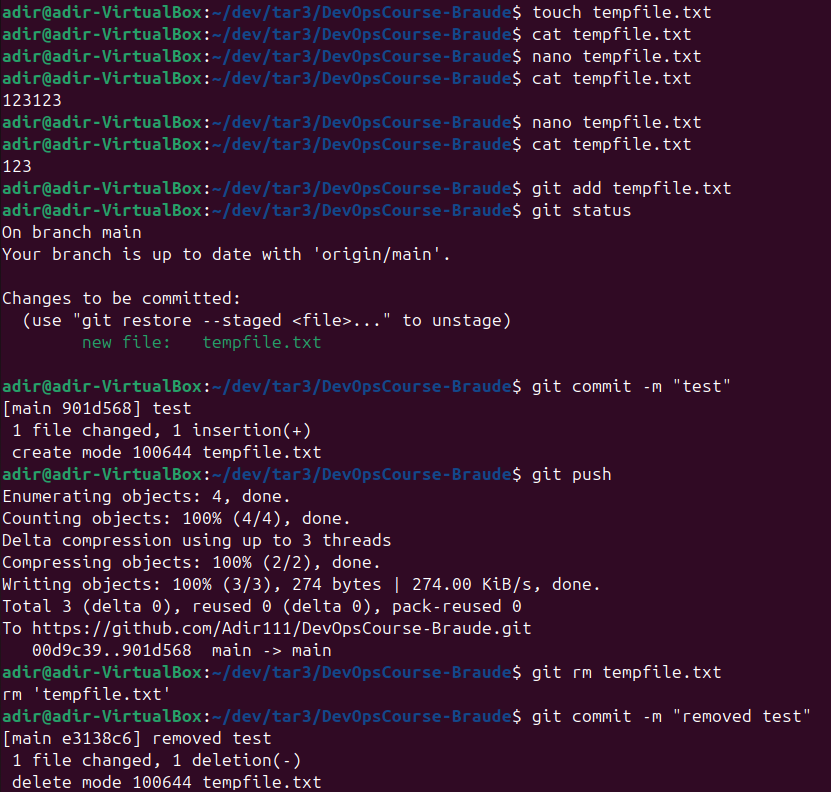
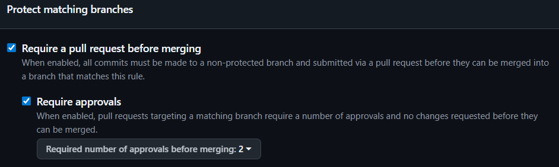

# 02 – Git & GitHub

Lecture 3. The team repository for this part is [Adir111/DevOpsCourse-Braude](https://github.com/Adir111/DevOpsCourse-Braude).

## 1. CRUD through Git

Created, read, updated and deleted a temp `.txt` file, committing and pushing each step:

```bash
touch tempfile.txt && git add tempfile.txt && git commit -m "test" && git push   # Create
cat tempfile.txt                                                                  # Read
nano tempfile.txt && git commit -am "update" && git push                          # Update
git rm tempfile.txt && git commit -m "removed test" && git push                   # Delete
```



## 2. Branch protection

Added the team as collaborators and protected `main`:

- every change must go through a pull request from a branch
- a merge needs **2 approving reviews**



## 3. Why Dependabot

Dependabot scans a project's dependencies and opens pull requests to update them when new versions or security fixes are released.
It belongs in any codebase that uses external libraries: nobody has to track updates by hand, known vulnerabilities get patched sooner, and maintenance work goes down.
