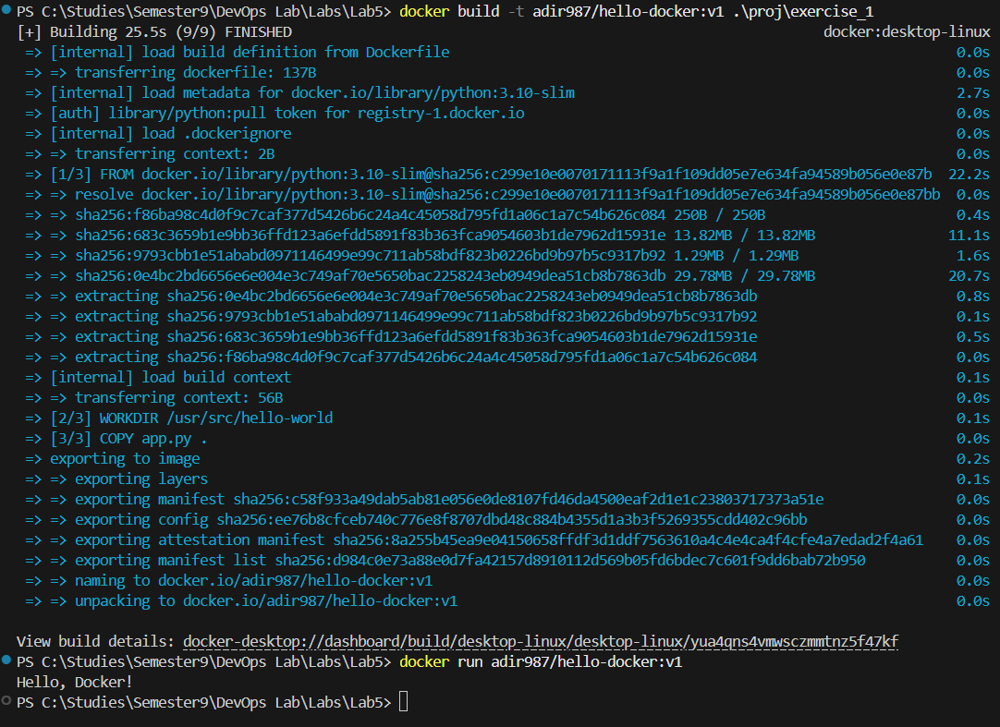

# 04 – Docker

Lecture 5.

## Running containers

- **Play with Docker:** ran `docker run -dp 80:80 docker/getting-started:pwd` on a cloud instance and opened the tutorial on the published port.
  `-d` runs the container in the background (detached); `-p 80:80` maps host port 80 to container port 80.
- **Docker Desktop:** ran the same tutorial image locally and opened it at `http://localhost/`.

## Containerizing an app

A minimal Python app packaged on the `python:3.10-slim` base image, as the exercise asked.

```dockerfile
FROM python:3.10-slim
WORKDIR /usr/src/hello-world
COPY app.py .
CMD ["python", "app.py"]
```

```bash
docker build -t hello-docker .
docker run --rm hello-docker     # -> Hello, Docker!
```


