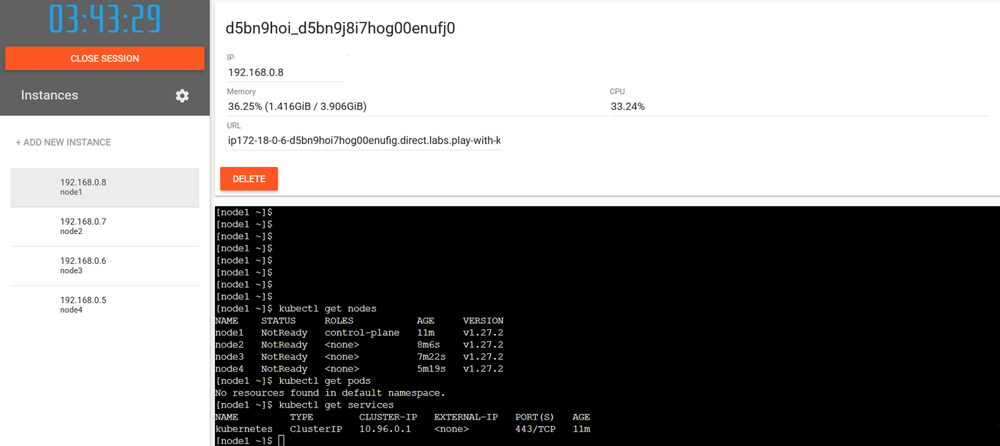
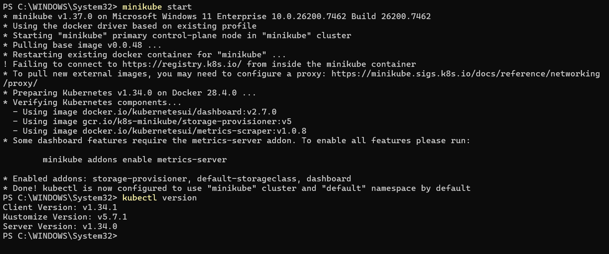
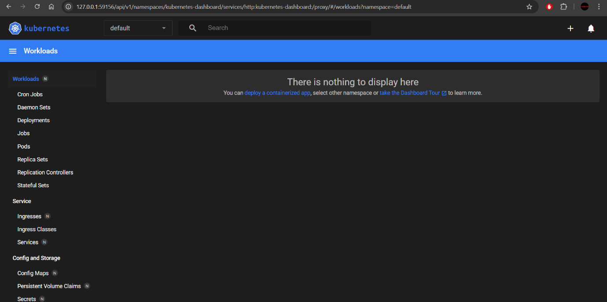
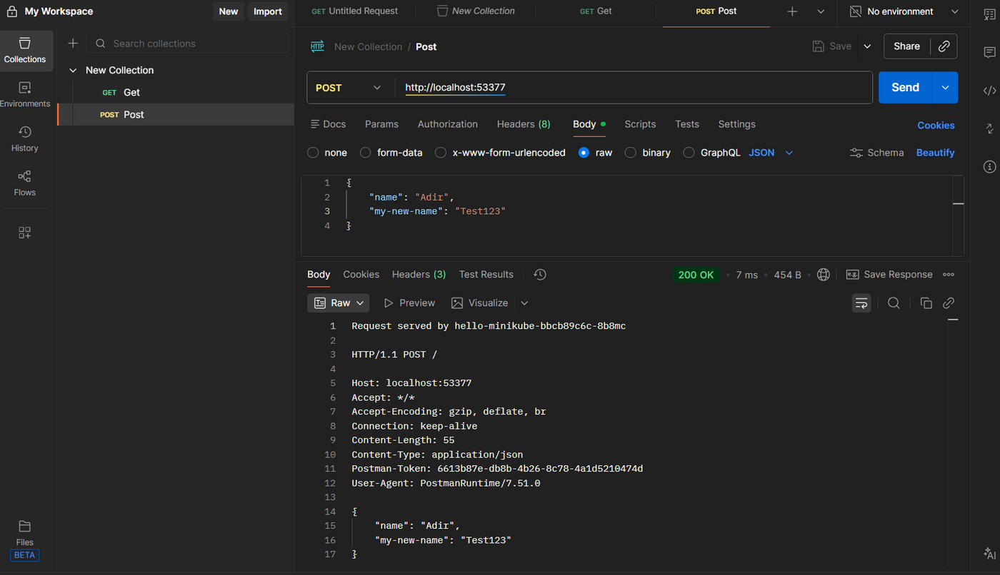

# 06 – Kubernetes

Lecture 7.

## Multi-node cluster with kubeadm

Built a cluster on Play with Kubernetes: one control-plane node plus **3 worker nodes** (the class example had fewer, and the exercise was to scale it to three).

```bash
# node1: initialise the control plane
kubeadm init ...

# node2-node4: join with the command printed by kubeadm init
kubeadm join <control-plane-ip>:6443 --token <token> --discovery-token-ca-cert-hash sha256:<hash>

# back on node1
kubectl get nodes
kubectl get services
```

All four nodes registered with the cluster (Kubernetes v1.27.2). They show `NotReady` because the exercise ended before a pod-network add-on was installed, which was outside its scope.



## Minikube

Ran locally on Windows with the Docker driver, following the Minikube getting-started steps:

```bash
minikube start
kubectl get pods -A                 # check which pods are running
minikube dashboard                  # web dashboard
kubectl create deployment hello-minikube --image=kicbase/echo-server:1.0
kubectl expose deployment hello-minikube --type=NodePort --port=8080
kubectl port-forward service/hello-minikube 53777:8080
```

Then called the service with GET and POST requests from the browser and from Postman.




